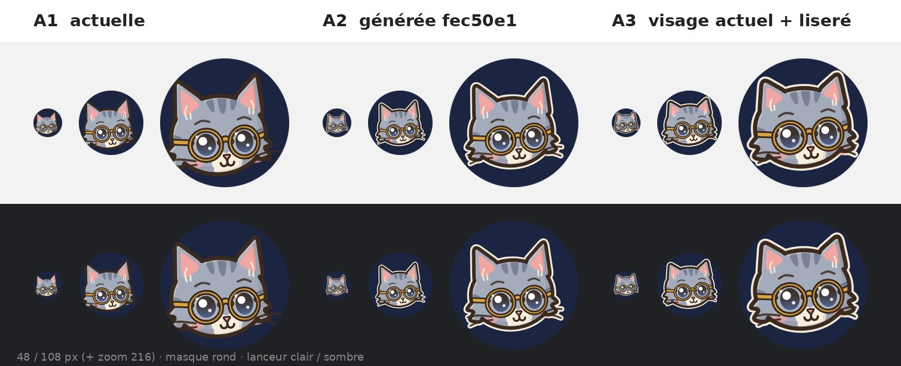
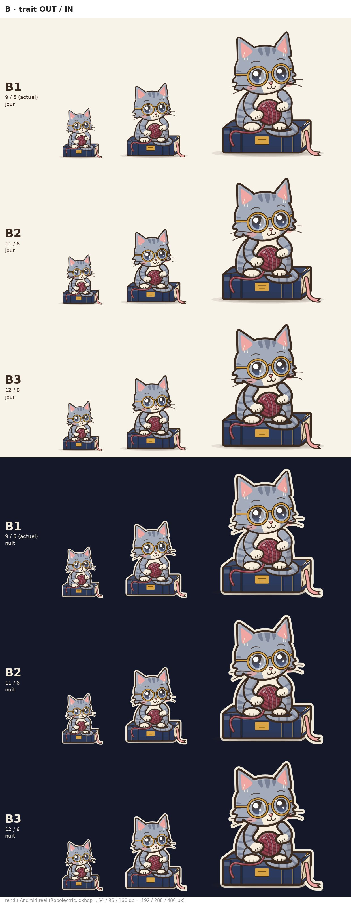
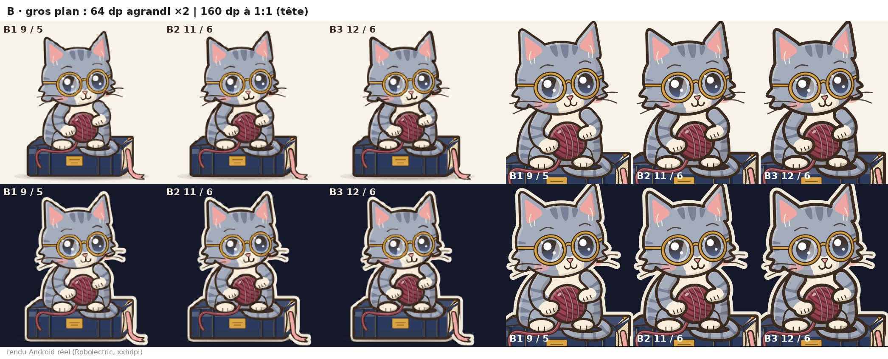
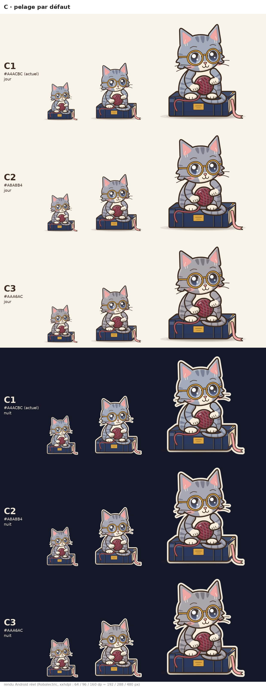
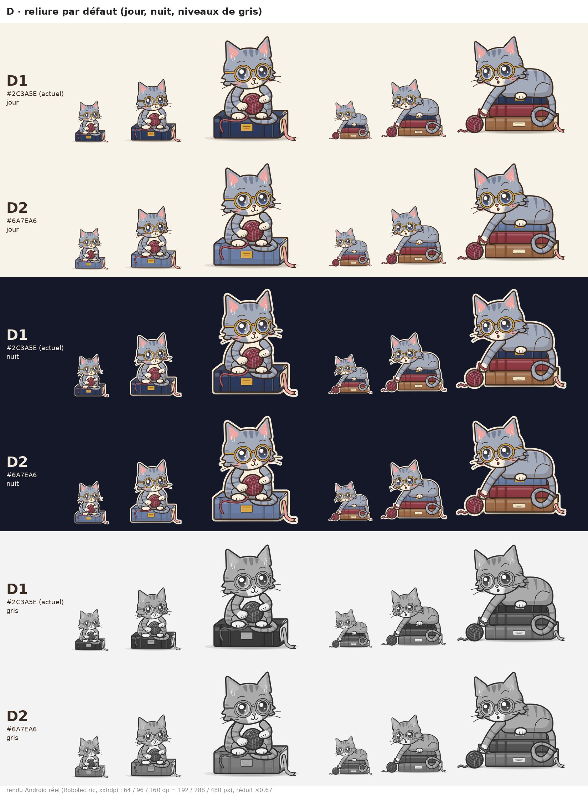

# Monsieur Glose : décisions de goût à prendre (nuit 5)

**Décision du propriétaire (8 nov., matin) : A3, B2, C3, D2, appliqués** (`make_android.js` `DEFAULT`, icône `a3` par défaut, trait 11/6 dans `glose_lib.js`). Les SVG de conception (`glose_*.svg`) gardent les anciennes teintes : seul le thème Android change.

Avant la décision : rien n'est appliqué dans l'appli. Chaque option se rend avec le générateur (`design/mascotte/android/make_android.js`, options
`GLOSE_RES`, `GLOSE_ICON`, `GLOSE_VARIANT`, `GLOSE_TOKENS` ; sans elles, la sortie est identique à aujourd'hui).
Rendus : **Android réels** (Robolectric, xxhdpi, jour et nuit), ressources candidates posées le temps du rendu puis retirées.
Pour l'icône, l'avant-plan est rendu par Robolectric puis posé sur le fond `icon_bg` et le masque rond par script
(Robolectric dessine mal le fond de l'icône adaptative).

Ma recommandation d'ensemble : **A3, B2, C3, D2**.

## A. Icône d'appli

| | Option | Pour | Contre |
|---|---|---|---|
| A1 | actuelle (faite à la main, échelle 0,15) | visage le plus grand, il remplit le rond | oreilles et joues coupées par le masque ; sans liseré, la tête se fond dans le bleu nuit sur lanceur sombre |
| A2 | générée, fec50e1 (échelle 0,13) | tient dans le masque, liseré crème | visage 14 % plus petit : se lit plus petit et moins rond |
| A3 | générée, visage actuel gardé (échelle 0,15), oreilles −20 %, moustaches −30 %, liseré crème | même taille de visage que A1 (lunettes : 199 px sur 432 dans les deux), tête entière visible (rayon max 35,7 sur 36), se détache sur lanceur sombre | oreilles un peu plus courtes que sur les poses ; moustaches plus courtes |

**Recommandation : A3.** Changement : dans `make_android.js`, `ICONS[process.env.GLOSE_ICON || 'a3']` (au lieu de `ICONS[process.env.GLOSE_ICON]`),
puis `node android/make_android.js` : réécrit `app/src/main/res/drawable/ic_launcher_fg.xml` (échelle 0,15, translation 16,8 / 17,4 ;
`ear: 0.8`, `whisk: 0.7`, liseré `#F0E8D8` h = 8). Couche monochrome inchangée.

## B. Épaisseur du trait

| | OUT / IN | Pour | Contre |
|---|---|---|---|
| B1 | 9 / 5 (actuel) | fin, élégant à 160 dp | contour mou à 64 dp (≈ 0,7 dp) |
| B2 | 11 / 6 | contour net à 64 dp, toujours léger à 160 dp | tous les dessins changent (vérifications visuelles à refaire) |
| B3 | 12 / 6 | le plus lisible à 64 dp | lourd à 160 dp (effet « autocollant »), les petits détails (doigts, yeux) s'empâtent |

**Recommandation : B2.** Changement : `design/mascotte/glose_lib.js`, `[OUT, IN] = VARIANT.trait || [11, 6]`, puis
`node android/make_android.js` (tous les `glose_*` régénérés ; même liste de fichiers, `GloseLayers.kt` inchangé).
Essai sans rien changer : `GLOSE_VARIANT='{"trait":[11,6]}'`.

## C. Pelage par défaut

| | Pelage / ombre | Pour | Contre |
|---|---|---|---|
| C1 | `#A4ACBC` / `#788196` (actuel) | net, propre | gris bleuté froid sur le papier crème ; de nuit, bleu sur bleu nuit |
| C2 | `#A8A8B4` / `#7C7C8C` | un cran plus neutre, garde l'accord avec les yeux bleus | écart faible avec C1 |
| C3 | `#AAA6AC` / `#7E7980` | gris chaud, s'accorde au papier crème et à l'or des lunettes ; de nuit, se sépare mieux du bleu | moins « gris bleu » : léger changement d'identité |

Essayé et écarté : `#ABA6A2` (taupe) : brunâtre, terne à côté de l'or. Même valeur de gris pour toutes : contraste inchangé.

**Recommandation : C3** (surtout avec D2 : un chat bleuté sur un livre bleu clair se confondrait). Changement :
`make_android.js` `DEFAULT` : `gloseFur '#AAA6AC'`, `gloseFurD '#7E7980'`, `gloseStripe '#7E7980'` ; pour garder les SVG de
conception alignés : `glose_lib.js` `SKINS.tigre` `fur/furD` et les clés `'#a4acbc'`, `'#788196'` de `TOKENS` dans `svg2avd.js`.
Essai : `GLOSE_TOKENS='{"gloseFur":"#AAA6AC","gloseFurD":"#7E7980","gloseStripe":"#7E7980"}'`.

## D. Reliure du livre

| | Reliure / ombre | Pour | Contre |
|---|---|---|---|
| D1 | `#2C3A5E` / `#1F2944` (actuel) | sobre, « bibliothèque » | la masse la plus sombre de l'image : à 64 dp l'œil va au livre |
| D2 | `#6A7EA6` / `#50638A` (bleu ardoise) | même famille de bleu ; le visage devient la zone la plus contrastée (contraste tête/livre en gris 1,04 → 1,24 le jour, 1,11 → 1,32 la nuit ; livre moyen 90 → 122 sur 255) | moins « précieux » ; la tasse de « soir » reste bleu nuit (jeton `gloseCup`, à aligner si on veut) |

Essayés et écartés : `#8494B8` (trop proche du pelage, le chat s'y fond) ; `#B4865A` (camel : se confond avec le livre sépia du bas
de la pile).

**Recommandation : D2.** Changement : `make_android.js` `DEFAULT` : `gloseBook` et `gloseBookTop '#6A7EA6'`, `gloseBookD` et
`gloseBookTopD '#50638A'` ; pour les SVG de conception : `C.night/nightD` (qui sert aussi à la tasse) remplacé par la nouvelle
reliure dans l'appel `book({ name: 'livre' … })` de `glose_lib.js` et pour `livre_haut` dans `pose_livres.js`. Les surcouches `Livre.Bordeaux` et `Livre.Verte` ne bougent pas.
